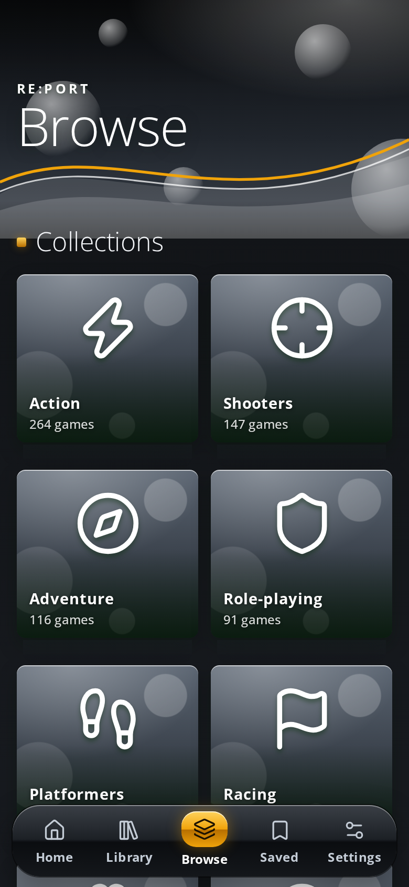
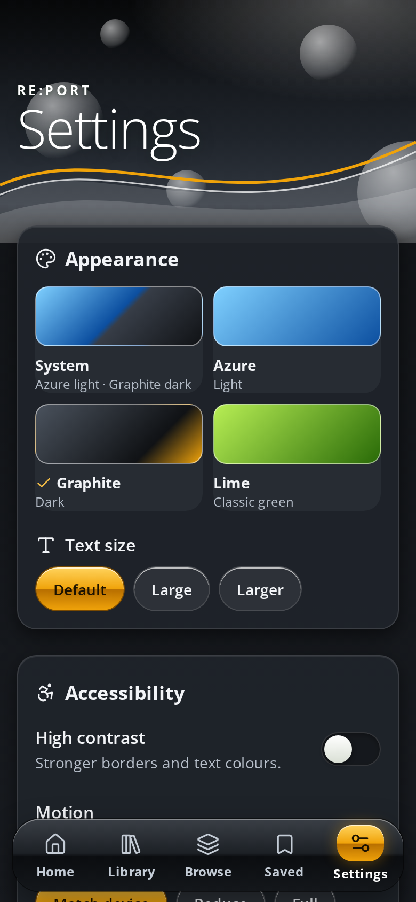
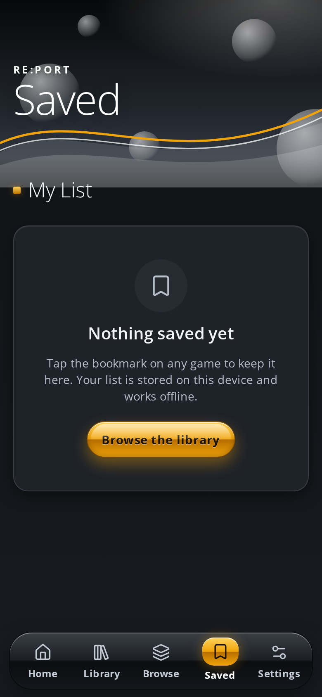
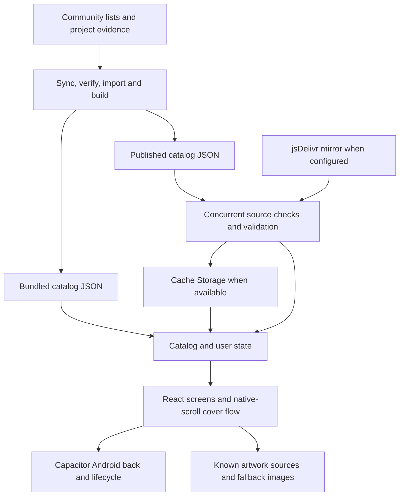

# Re:Port

An Android library for discovering community game ports, their projects, and their requirements.

[](https://github.com/Nazatric/Re-Port/actions/workflows/android-apk.yml)
[](https://github.com/Nazatric/Re-Port/releases/latest)
[](https://github.com/Nazatric/Re-Port/releases/latest)
[](https://github.com/Nazatric/Re-Port/releases/tag/v1.0)
[](#license-and-credits)

[Download the Android APK](https://github.com/Nazatric/Re-Port/releases/latest) · [Changelog](CHANGELOG.md) · [Development guide](docs/development.md)

Re:Port collects Android-targeted source ports, engine rebuilds, decompilations, and recompilation projects in a searchable catalog. It is a directory, not an emulator, and does not include game files. Each project has its own requirements and compatibility; follow its linked instructions before installing.

## What is inside

- **Browse and search:** collections, original-platform filters, project sources, compatibility reports, file requirements, and controller support.
- **Project details:** available ports, screenshots, source links, and live GitHub release information where available.
- **A personal library:** saved titles and recent history stored on the device, with Azure, Graphite, Lime, and system themes.
- **Offline baseline:** the bundled catalog opens without a network connection. Published catalog updates can be adopted without shipping another APK.
- **Accessible controls:** adjustable text, contrast and motion, keyboard navigation, focus management, and Android system-back handling.

## Install

1. Download the universal APK from the [latest release](https://github.com/Nazatric/Re-Port/releases/latest). Android 7.0 or newer is required.
2. Open the file on your device and follow Android's installation prompts. You may need to allow installation from the app opening the APK.
3. Open Re:Port, find a game, and follow the relevant project's installation instructions.

The published V1.0 APK uses the **debug build variant** and is intended for testing. Android cannot update an installation signed with a different key. Uninstalling that installation may erase your saved list and other local data; back up anything you need first.

## Screenshots

These are direct captures of the current web interface in a Chromium phone-sized viewport, not physical-device certification. Each is 780 × 1688 pixels, preserving the 390 × 844 viewport's aspect ratio. Tap or click a capture to see it at full size.

<p align="center">
  <a href="docs/screenshots/browse.png"></a>
  <a href="docs/screenshots/settings.png"></a>
  <a href="docs/screenshots/saved.png"></a>
</p>

<details>
<summary>Previously supplied app presentation images</summary>

[Spotlight in Graphite](docs/images/spotlight-graphite.png) · [Collections](docs/images/collections-graphite.png) · [Cover flow](docs/images/cover-flow-graphite.png) · [Saved](docs/images/saved-graphite.png) · [Settings](docs/images/settings-azure.png) · [Lime](docs/images/spotlight-lime.png) · [Azure](docs/images/spotlight-azure.png)

</details>

## Engineering overview

| Area | Current implementation | Boundaries |
| --- | --- | --- |
| Rendering | Native scrolling and snap points for cover flow; scroll painting is scheduled with `requestAnimationFrame`. Reduced motion is supported. | No physical-device 120 fps measurement or frame-budget guarantee. Search and catalog parsing still run on the main thread. |
| Catalog | Bundled JSON loads first. A validated newer cached copy can be restored, then remote sources are checked in the background. Simultaneous checks are coalesced. | Cache Storage can be unavailable or evicted. There is no byte-bounded in-memory LRU or worker-based indexing. |
| Network | Configured public GitHub raw catalog, a jsDelivr mirror when applicable, and the bundled file are checked concurrently. Requests have deadlines and one retry for transient failures. | Public services can be unavailable or stale; no API key is needed. A custom URL must permit cross-origin requests. |
| Artwork | Curated project, Steam, LaunchBox, and Libretro URLs are used when available. Cover and screenshot views fall back to other known images or a labelled placeholder. | Browser service workers cache selected artwork; Android WebView manages its own cache. Artwork is not guaranteed offline. |
| Android | Capacitor wraps the web app; the native back callback handles dialogs before navigation. The CI build checks universal ABI coverage. | The workflow currently builds a debug-variant APK. It does not configure R8, ABI splits, or production signing. |

## Architecture



Catalog entries need per-port Android evidence. Metadata matching is conservative: unknown genres and platforms are not guessed. Evidence does not guarantee a working APK or compatibility on a particular device. See [catalog and evidence](docs/development.md#catalog-and-evidence) for the pipeline and source notes.

## Build locally

Use Node.js 22 and npm. Android builds also require a JDK and the Android SDK.

```sh
npm ci
npm run dev
```

```sh
npm test
npm run typecheck
npm run build
node scripts/verify-build.mjs
```

For a local Android debug build, from a clean checkout without an existing generated `android/` directory:

```sh
npm run build
npx cap add android
node scripts/configure-android-theme.mjs
npx cap sync android
cd android
./gradlew assembleDebug
```

The generated APK is at `android/app/build/outputs/apk/debug/app-debug.apk` relative to the repository root. The automated build also installs the prepared launcher icons and runs browser regression checks; see the [Android workflow](.github/workflows/android-apk.yml).

### Signing a release build

Production signing is **not configured in the current workflow**. To build and sign locally, first create or select a keystore and retain it securely as described in the [signing guide](docs/android-release.md). Never commit it or share passwords. After generating and syncing the Android project as above, run from the repository root:

```sh
(cd android && ./gradlew assembleRelease)
BT="$ANDROID_HOME/build-tools/$(ls "$ANDROID_HOME/build-tools" | sort -V | tail -n 1)"
"$BT/zipalign" -p -f 4 android/app/build/outputs/apk/release/app-release-unsigned.apk app-release-aligned.apk
"$BT/apksigner" sign --ks "$HOME/re-port-release.jks" --ks-key-alias report --out RePort-release.apk app-release-aligned.apk
"$BT/apksigner" verify --verbose RePort-release.apk
```

Adjust the keystore path and alias to your own; `apksigner` prompts for the password. Keep the same signing key for future updates. This command produces a release APK, but its behavior and signature should be verified on a device before distribution.

## Project structure

```text
src/components/     Shared controls, artwork and cover-flow interactions
src/pages/          App screens
src/lib/            Catalog queries, routing, stores, images and network logic
src/data/           Bundled generated catalog
public/             Published catalog and web assets
scripts/            Source import, verification, build and regression checks
data/source/        Source snapshots, evidence and curated corrections
docs/               Development, signing and screenshot documentation
.github/workflows/  Android build and scheduled catalog refresh
```

## License and credits

No repository license has been specified. See [sources and credits](docs/development.md#sources-and-credits) for the community lists, databases, artwork archives, and port developers that make the library possible. Game names, logos, and artwork belong to their respective owners.
