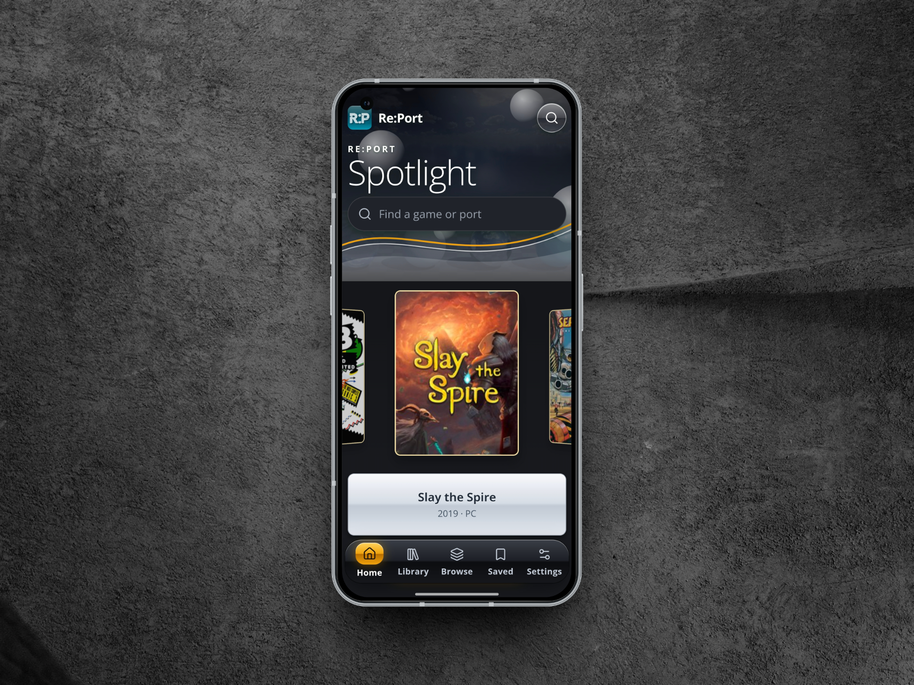
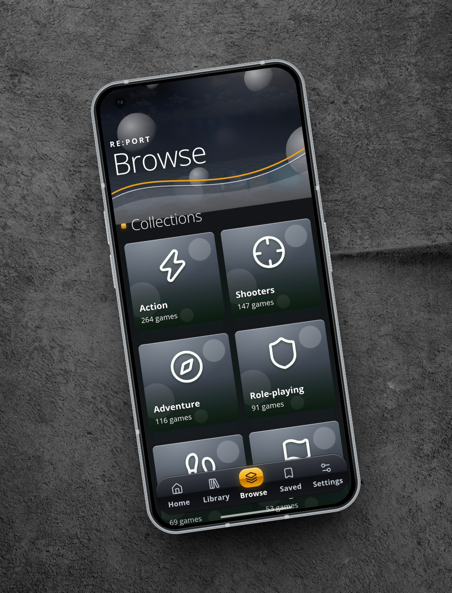
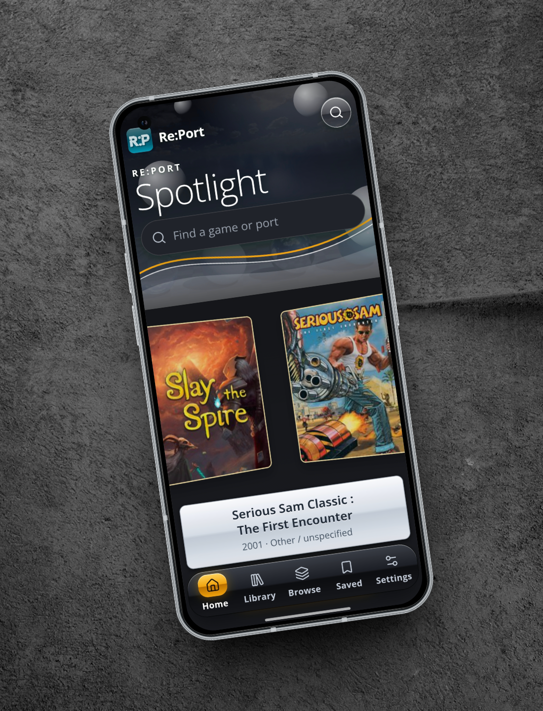
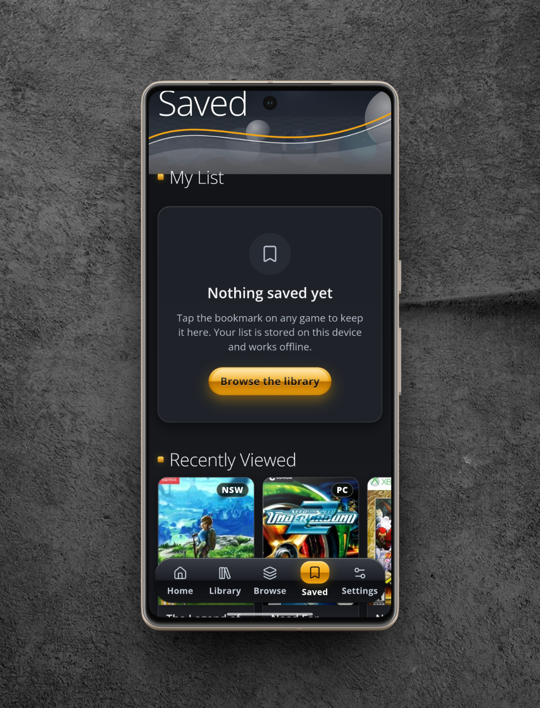
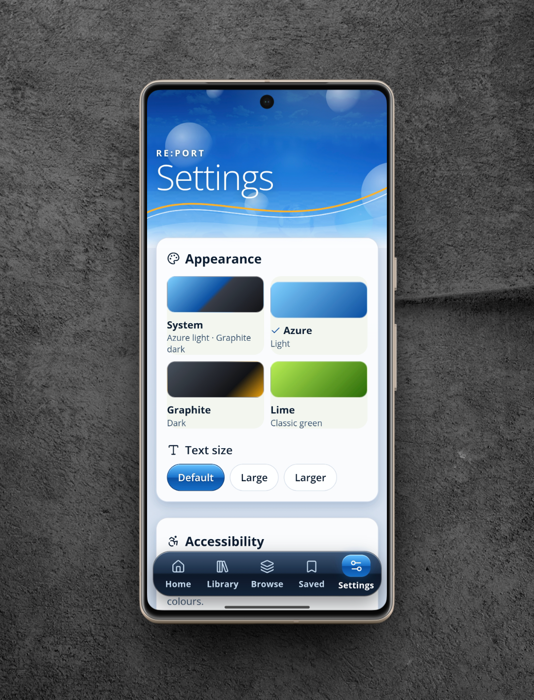

  

  <strong>A little more room for the games you love.</strong> 
  Discover unofficial Android ports, explore their projects, and keep your favourites close.

  <a href="https://github.com/Nazatric/Re-Port/releases/latest"><strong>Download for Android</strong></a>
  &nbsp;&nbsp;·&nbsp;&nbsp;
  <a href="#a-closer-look">Take a closer look</a>
  &nbsp;&nbsp;·&nbsp;&nbsp;
  <a href="CHANGELOG.md">Changelog</a>

  

## Find your next port

Re:Port brings community Android projects together in a library made for browsing. From source ports and engine rebuilds to decompilation and recompilation projects, each entry helps you find the people and pages behind the work.

**Browse your way.** Search by name, explore collections, and narrow the library by original platform, source, compatibility, file requirements, or controller support.

**See the details.** Open a game to find its available projects, screenshots, requirements, and links. When an Android release is known, the download button takes you there; otherwise it opens the project or its listed source.

**Make it yours.** Save games for later, revisit recent finds, and choose between Azure, Graphite, Lime, or your system appearance. Text size, contrast, and motion settings are there when you need them.

## A closer look

From the cover flow to the collections, Re:Port is designed to feel at home on a phone. The gallery uses lossless crops to bring the screens closer; select any image to open the untouched, full-resolution original.

  
  

Explore collections &nbsp; · &nbsp; Move through the spotlight

  
  

Keep a personal list &nbsp; · &nbsp; Set your own appearance

  
  

Azure &nbsp; · &nbsp; Lime

## Get Re:Port

Download the **universal APK** from the [latest release](https://github.com/Nazatric/Re-Port/releases/latest), open it on your Android device, and follow Android's installation prompts. You may need to allow installs from the app you use to open the file.

The current APK uses the Android debug build variant and is intended for testing. If an existing installation was signed with a different key, Android will require you to uninstall it first. **Uninstalling can erase your saved list and other local app data**, so back up anything you need before proceeding.

Re:Port is a directory, not an emulator or a collection of game files. Individual projects may require your own legally obtained files, a separate build, or particular hardware. Availability and compatibility can change; check the linked project for its current instructions.

## The library, explained

The bundled catalog is available offline. Artwork is loaded and cached as you browse, and the catalog can refresh over the internet without a new app release. Source-platform labels describe the original game, not a claim that a port runs on that platform.

We use Android-focused community lists and independently check GitHub projects for Android evidence. A listed APK or README is not a guarantee that a port will work on every device. Where genre, platform, or project details are uncertain, the catalog can leave them unspecified rather than guess. Screenshots may show a different version of a game.

## Built with care

Re:Port is built with React, TypeScript, and Vite, wrapped for Android with Capacitor. If you would like to explore the code or help improve the catalog, start with the [development guide](docs/development.md). For changes in each version, see the [changelog](CHANGELOG.md).

The library is possible thanks to the community lists, game databases, artwork archives, and port developers behind it. See the [source and credits notes](docs/development.md#sources-and-credits). Game names, logos, and artwork belong to their respective owners.
