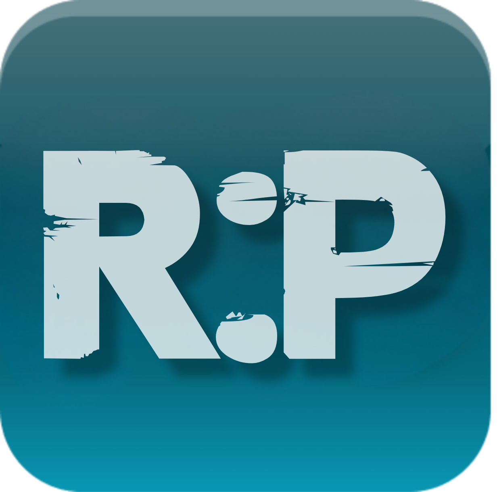
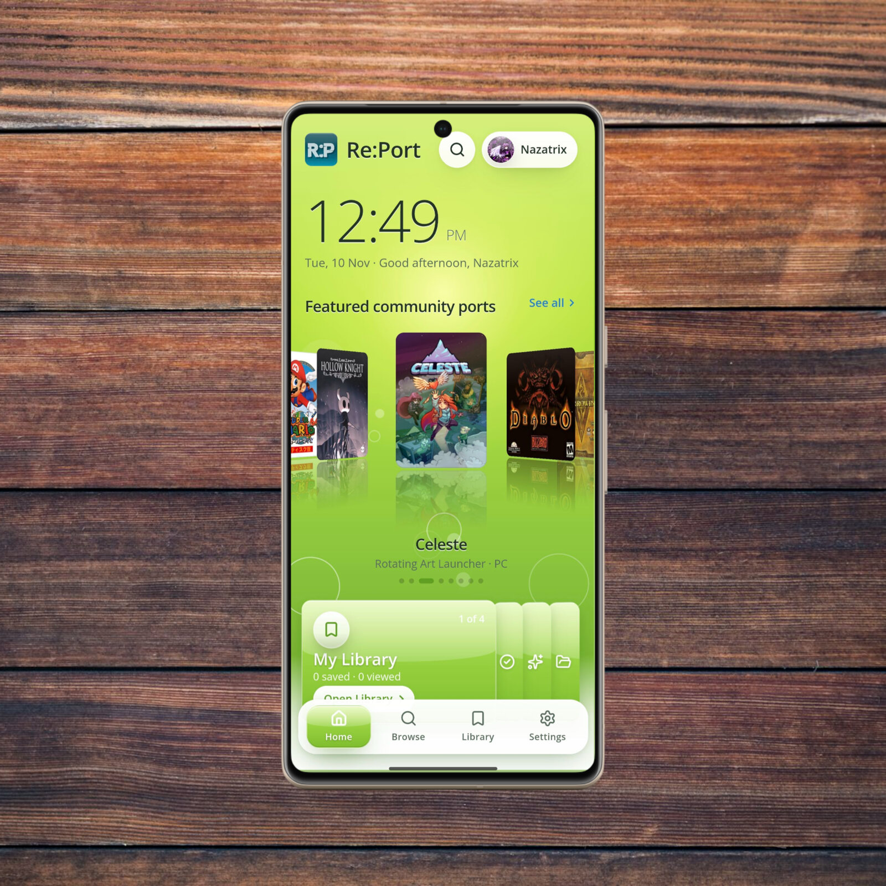
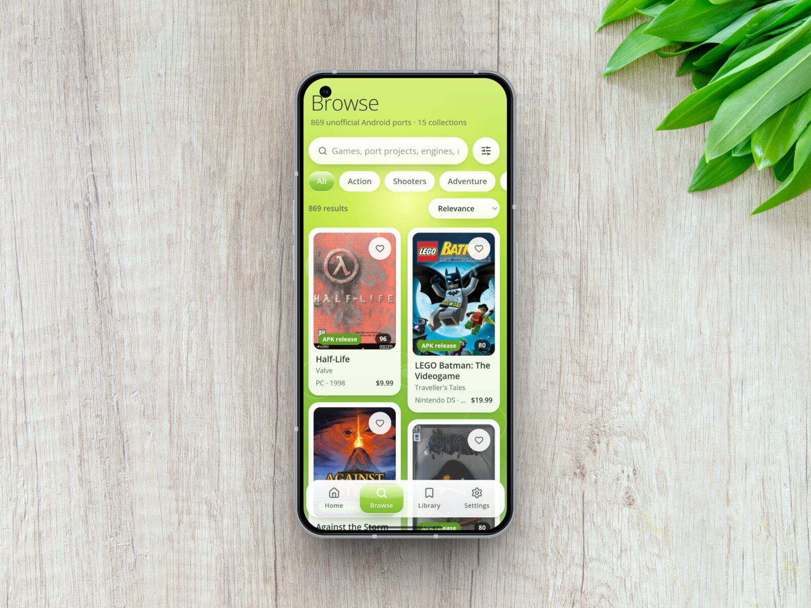
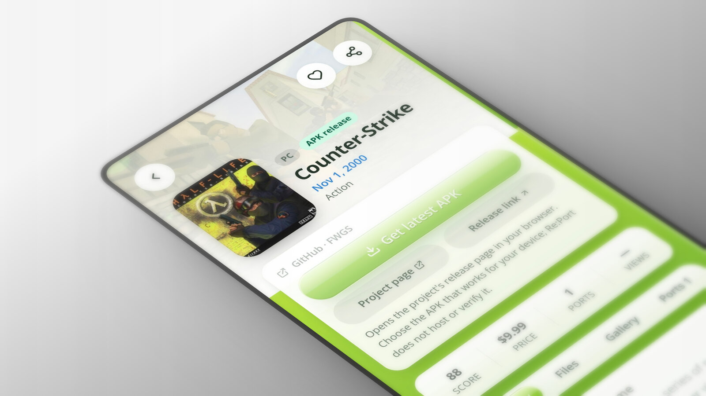
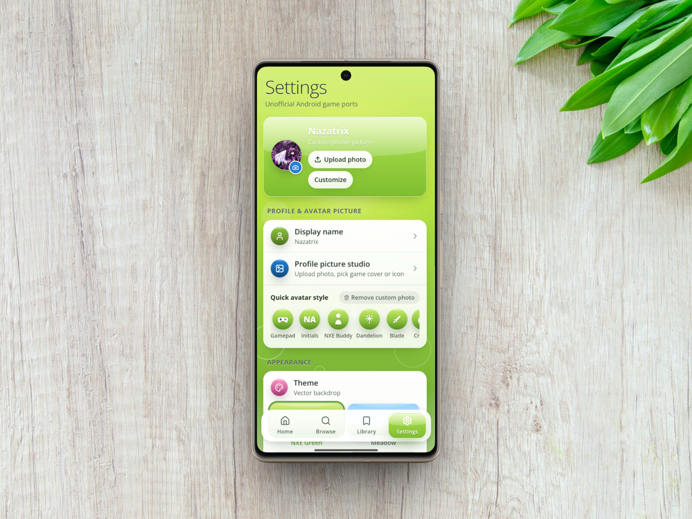
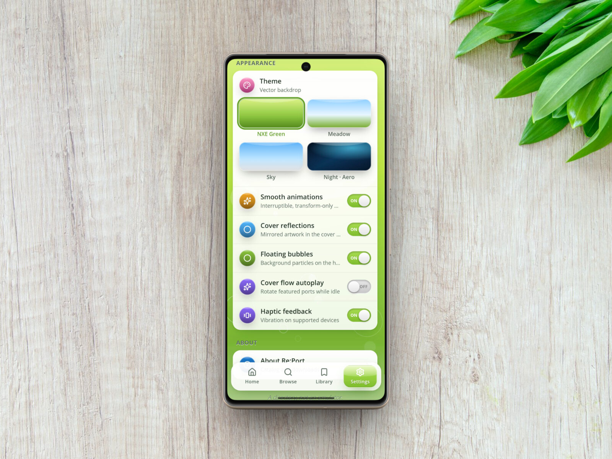

<div align="center">
  

  # Re:Port

  **A little home for a big world of Android game ports.**

  Discover community projects, explore their requirements, and find your next game — all in one glossy, pocket-sized directory.

  [**Download for Android**](https://github.com/Nazatric/Re-Port/releases/tag/v1.0.0) · [Explore the app](#inside-report) · [Build it yourself](#build-from-source)

  <sub>869 games in the bundled catalog &nbsp;✦&nbsp; 15 collections &nbsp;✦&nbsp; Made for Android</sub>
</div>

<br />

<div align="center">
  
</div>

> **A directory, not an emulator.** Re:Port helps you find community-made ports and their official project pages. It does not include games, ROMs, original game files or keys.

---

## A better way to find your next port

Somewhere between a project README and a release page, there's usually a great game waiting to be found. Re:Port brings those scattered discoveries together in an interface that feels like a place worth visiting.

- **Browse your way** — search games, engines and projects; filter by platform, collection, files needed and more.
- **Get the details** — see port projects, setup requirements and links to their own release pages.
- **Keep favorites close** — save ports and pick up where you left off with recently viewed games.
- **Make it yours** — choose a theme, customize your profile and add an animated GIF avatar.
- **Enjoy the little things** — cover flow, reflections and glossy surfaces bring a little nostalgia to every scroll.

## Inside Re:Port

<div align="center">
  
  
</div>

<div align="center"><sub>Find something new &nbsp;✦&nbsp; Get the context before you install</sub></div>

<br />

<div align="center">
  
  
</div>

<div align="center"><sub>Your profile &nbsp;✦&nbsp; Your kind of atmosphere</sub></div>

## Get the app

1. Open the [Re:Port Android release](https://github.com/Nazatric/Re-Port/releases/tag/v1.0.0) and download **`Re-Port.apk`** from Assets.
2. Open the APK on an Android device (Android 7.0 / API 24 or newer). You may need to allow installations from your browser or file manager.
3. Open Re:Port, pick a profile and start exploring.

> [!WARNING]
> This preview APK uses a **debug signing certificate**, not a private production signing key. It is for testing and is not suitable for Google Play or trusted production distribution. Different builds may have different certificates: Android may require you to uninstall an older version first, which can erase its local data.

The catalog is bundled for offline browsing. Artwork and external project pages require a connection. Releases are hosted by their respective projects; choose an APK appropriate for your device and review the source yourself. Re:Port does not host those files, verify their signatures or install them for you.

## Build from source

The Android app wraps the React and Vite interface with Capacitor. You'll need **Node.js 22**, **JDK 21** and an **Android SDK** for the Android build.

```bash
npm ci
npm run typecheck
npm run build
npx cap add android             # first time only
node scripts/prepare-android.mjs
npx cap sync android
cd android
./gradlew assembleDebug
```

The local build produces `android/app/build/outputs/apk/debug/app-debug.apk`. The Android project is generated and ignored by Git; run the preparation script after creating it so the icon and launch theme are applied. No production signing key is configured.

For a browser preview, run `npm run dev`. To run the automated checks, build first, then run `node scripts/test-release-links.mjs`, `node scripts/smoke-web.mjs`, `node scripts/smoke-profile-performance.mjs` and `node scripts/smoke-overlays.mjs` with Chromium available to Playwright (or set `CHROMIUM_PATH`).

<details>
<summary><strong>A few things worth knowing</strong></summary>

- Port ordering uses the bundled catalog's download counts. They can be outdated or unavailable.
- Known GitHub prereleases open the releases list; other GitHub APK projects open the latest stable release page. Other sources retain their own links.
- Game titles, artwork and project names belong to their respective owners. Re:Port is an unofficial directory, not an endorsement by those projects.
- This source and README are on the active development branch. The repository's default branch is separate.

</details>

---

<div align="center">
  <strong>Find something wonderful. Take it with you.</strong><br />
  <sub>Made for the communities keeping games alive.</sub>
</div>
