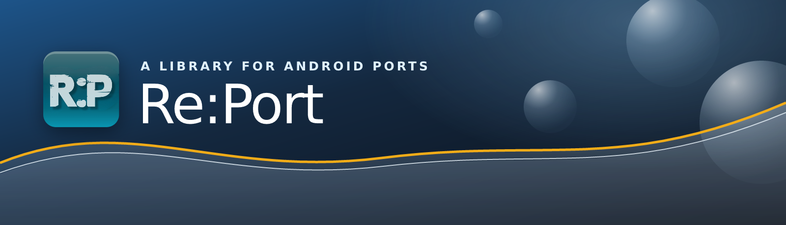
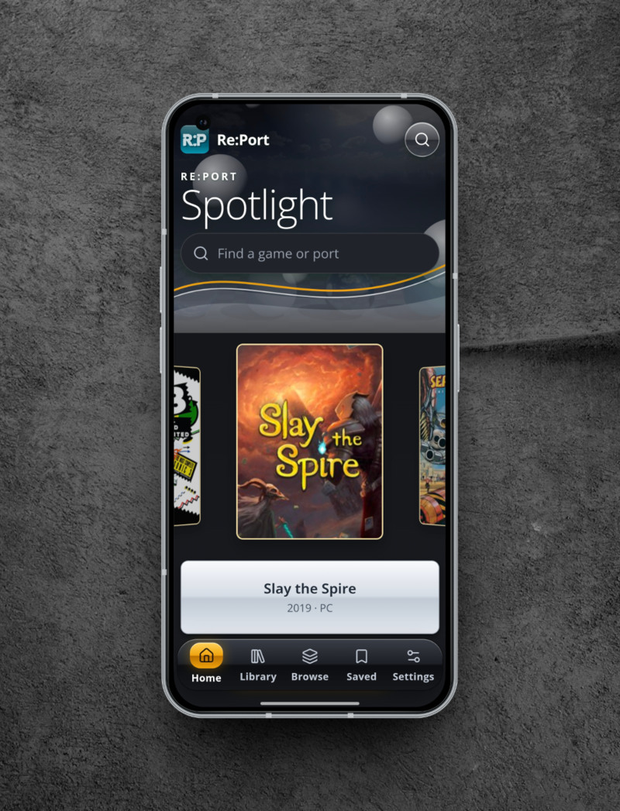
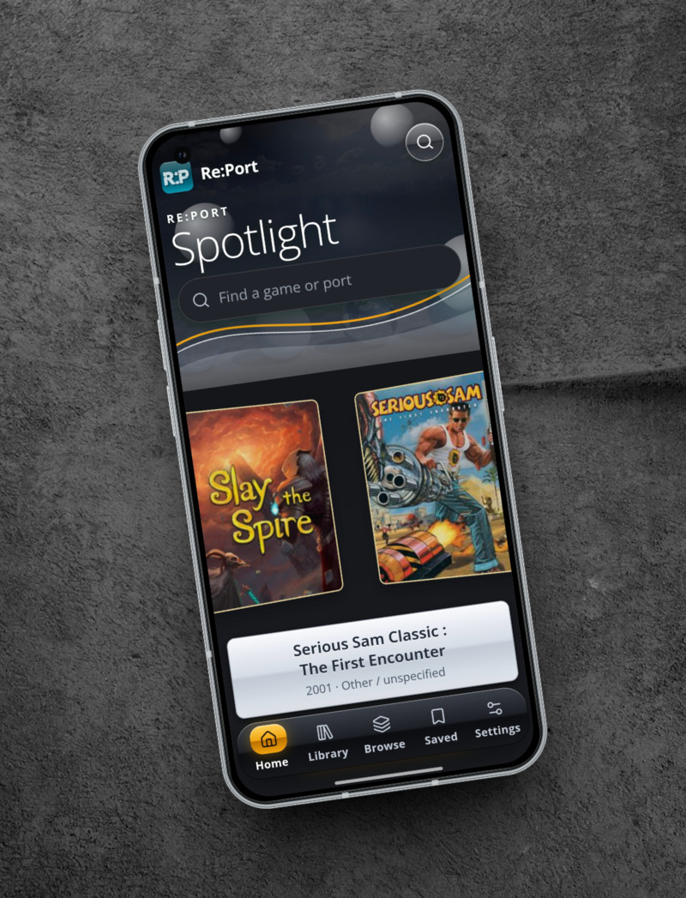
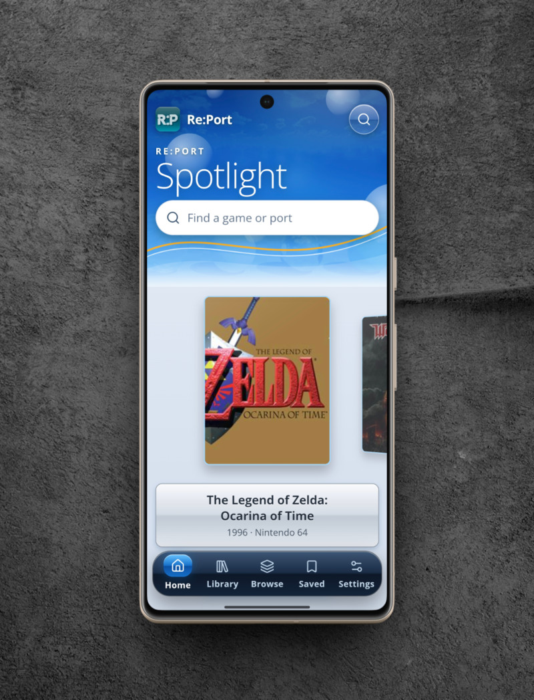
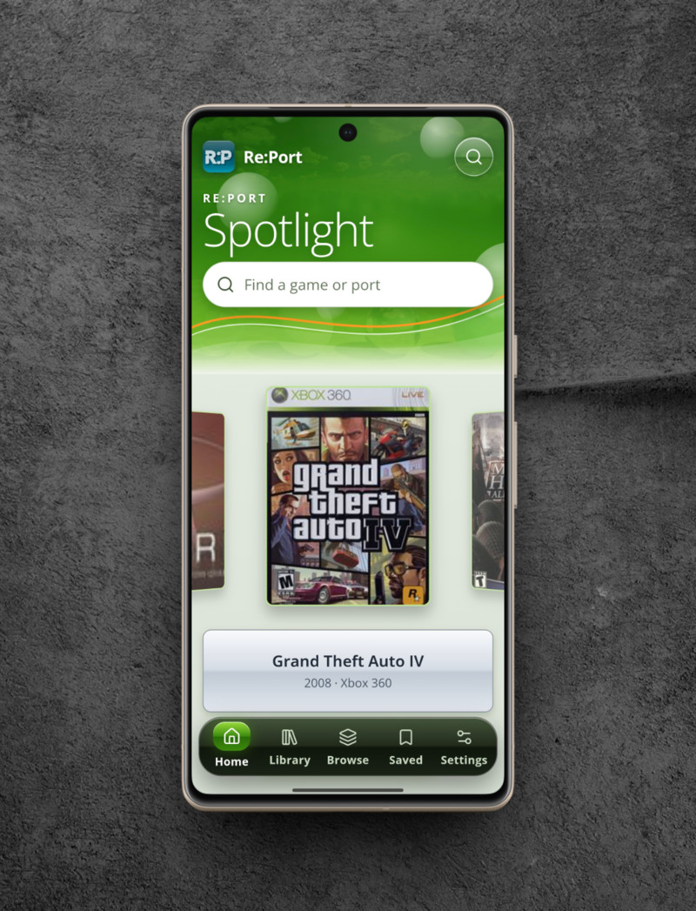

<p align="center">
  
</p>

<h1 align="center">A home for Android game ports</h1>

<p align="center">
  Find the projects bringing familiar games to Android.<br>
  Browse the library, discover something new, and keep your favourites close.
</p>

<p align="center">
  <a href="https://github.com/Nazatric/Re-Port/releases/latest"></a>
</p>

<p align="center">
  <a href="#inside-report">Explore the app</a> &nbsp;&nbsp;
  <a href="#screenshots">Screenshots</a> &nbsp;&nbsp;
  <a href="CHANGELOG.md">Changelog</a> &nbsp;&nbsp;
  <a href="docs/development.md">Development</a>
</p>

<p align="center">
  <a href="docs/images/spotlight-graphite.png"></a>
  <a href="docs/images/collections-graphite.png"></a>
</p>

## Inside Re:Port

Re:Port is a place to discover unofficial Android projects, from source ports and engine rebuilds to decompilation and recompilation projects. It brings their details together so you can find the people and pages behind each port.

**Find something to play.** Search the library, browse collections, or filter by original platform, source, compatibility, file requirements, and controller support.

**Get to know a project.** Game pages bring together available ports, screenshots, requirements, and links. When an Android release is known, the download button leads there; otherwise, it opens the project or its listed source.

**Keep it close.** Save favourite games on your device and revisit recently viewed titles. Choose Azure, Graphite, Lime, or system appearance, with text size, contrast, and motion options to make the app comfortable for you.

## Get started

1. Download the **universal APK** from the [latest release](https://github.com/Nazatric/Re-Port/releases/latest).
2. Open the APK on your Android device and follow the installation prompts. Android may ask you to allow installs from the app you use to open it.
3. Open Re:Port and start exploring. Android 7.0 or newer is required.

The current APK uses the Android debug build variant and is intended for testing. If an existing installation was signed with a different key, Android requires it to be uninstalled first. **Uninstalling can erase your saved list and other local app data**, so back up anything you need before proceeding.

Re:Port is a directory, not an emulator or a collection of game files. Individual projects may require your own legally obtained files, a separate build, or particular hardware. Check the linked project for its current instructions and device compatibility.

## Screenshots

A closer look at the app, from its cover flow to the different themes. Select any image to open the original, full-resolution screenshot.

<p align="center">
  <a href="docs/images/cover-flow-graphite.png"></a>
  <a href="docs/images/saved-graphite.png"></a>
</p>
<p align="center"><sub>Spotlight and your saved list</sub></p>

<p align="center">
  <a href="docs/images/settings-azure.png"></a>
  <a href="docs/images/spotlight-azure.png"></a>
  <a href="docs/images/spotlight-lime.png"></a>
</p>
<p align="center"><sub>Make Re:Port feel like yours</sub></p>

## About the library

The bundled catalog is available offline. Artwork is loaded and cached as you browse, and the catalog can refresh over the internet without a new app release. Platform labels describe the original game, not the device on which a port runs.

The catalog draws on community lists and checks GitHub projects for Android evidence. A listed APK or README is not a guarantee that a port will work on every device. When genre, platform, or project details are uncertain, they can remain unspecified rather than guessed. Screenshots may show a different version of a game.

## Made with the community

Re:Port is built with React, TypeScript, Vite, and Capacitor. To run it locally, use Node.js 22:

```sh
npm ci
npm run dev
```

For Android builds, catalog sources, and ways to help, see the [development guide](docs/development.md). Found a problem or know of a project that could be listed? [Open an issue](https://github.com/Nazatric/Re-Port/issues).

The library is possible thanks to community lists, game databases, artwork archives, and port developers. Read the [sources and credits](docs/development.md#sources-and-credits). Game names, logos, and artwork belong to their respective owners.
