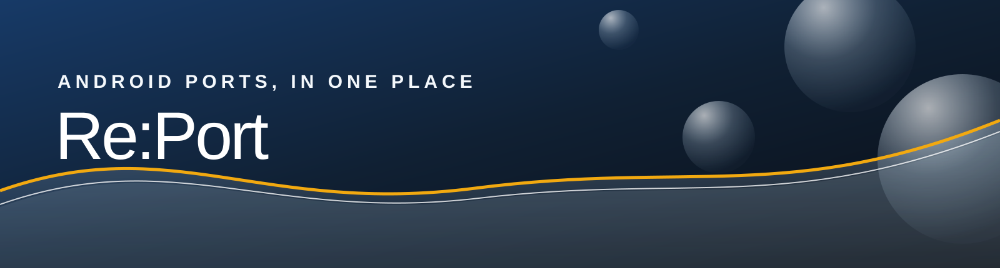

  

A little more room for the games you love. Re:Port V1.0 brings community Android game ports together in a library made for your phone.

**[Download RePort V1.0 Universal APK](https://github.com/Nazatric/Re-Port/releases/download/v1.0/RePort-V1.0-Universal.apk)**

## Your library, your way

Explore source ports, engine rebuilds, decompilation projects and recompilations. Search for a game, browse collections, or narrow the list by platform, source, compatibility, file requirements and controller support. Each game page brings together its projects, screenshots and links so you can find the work behind the port.

Save favourites on your device, return to recently viewed games and make the app your own with Azure, Graphite, Lime or system appearance. Text size, contrast and reduced-motion options are available in Settings.

The bundled catalog works offline. Artwork is loaded as you browse, and the catalog can refresh over the internet without a new APK.

## Install on Android

Download the universal APK above and open it on your Android device. Android may ask you to allow installs from the app used to open the file. The APK is a single build for Android devices rather than separate CPU-specific downloads.

**This release uses the Android debug build variant and is intended for testing.** If a previous installation was signed with a different key, Android will require you to uninstall it before installing this one. Uninstalling can erase local app data, including your saved list; back up anything you need first.

## A note about the catalog

Re:Port is a directory of projects, not an emulator or a collection of game files. Some ports require legally obtained game files, a source build or particular hardware. Availability and compatibility depend on the individual project and device; consult the linked project for current instructions.

The catalog uses Android evidence and conservative metadata matching, but listings can be incomplete or change over time. Unknown genres and platforms are left unspecified, and screenshots may depict a different version of a game.

---

Explore the [project page](https://github.com/Nazatric/Re-Port) or read the [full changelog](https://github.com/Nazatric/Re-Port/blob/main/CHANGELOG.md).
