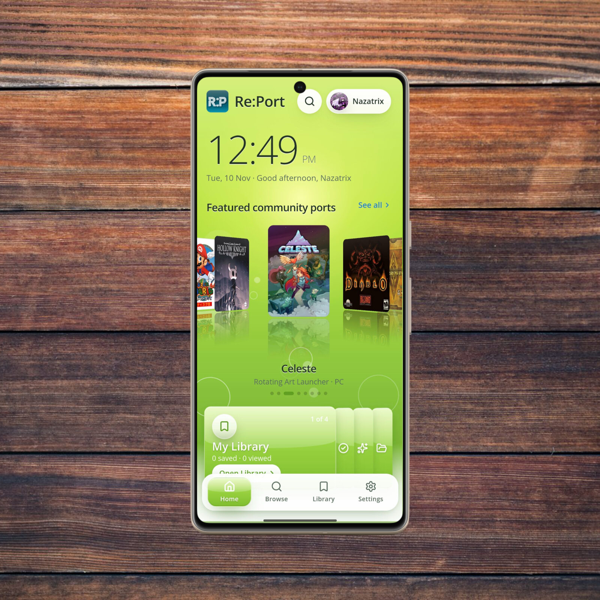

  <h2>A little home for a big world of Android game ports.</h2>
  
Discover community projects, explore their requirements, and find your next game — all in one pocket-sized directory.

  
<a href="https://github.com/Nazatric/Re-Port/releases/download/v1.0.0/Re-Port.apk"><strong>⬇ Download Re-Port.apk</strong></a>

  
Android 7.0+ &nbsp;✦&nbsp; 907 games in the bundled catalog &nbsp;✦&nbsp; 15 collections

  

## ✨ What's inside

- **Explore:** Search and filter the catalog by collection, platform, requirements and more.
- **Get the details:** Compare community ports and open their official project and release pages.
- **Make it yours:** Save favorites, add an animated GIF avatar and choose from four themes.
- **Enjoy the details:** Cover flow, reflections and glossy surfaces bring a little nostalgia to every scroll.
- **Latest fixes:** Filter actions sit above the navigation, with smoother Browse and blade rendering.

## 📲 Install

1. Download **[Re-Port.apk](https://github.com/Nazatric/Re-Port/releases/download/v1.0.0/Re-Port.apk)** below or from the Assets section.
2. Open it on an Android 7.0 or newer device. If prompted, allow your browser or file manager to install apps.
3. Open Re:Port, set up your profile and start exploring.

> [!WARNING]
> **This APK is debug-signed, not signed with a private production key.** It is a testing build and is not suitable for Google Play or trusted production distribution. Android may require you to uninstall an older build with a different signing certificate; uninstalling can erase local data.

## 🌱 Good to know

Re:Port is a **directory, not an emulator**. It does not include game data, ROMs or keys, and does not verify third-party APK signatures. The catalog is bundled for offline browsing; artwork and external project pages need a network connection. Game titles and artwork belong to their respective owners.

  <strong>Find something wonderful. Take it with you.</strong>

